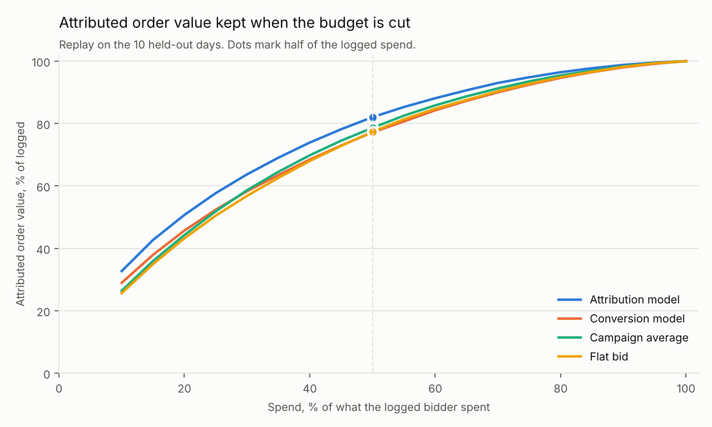
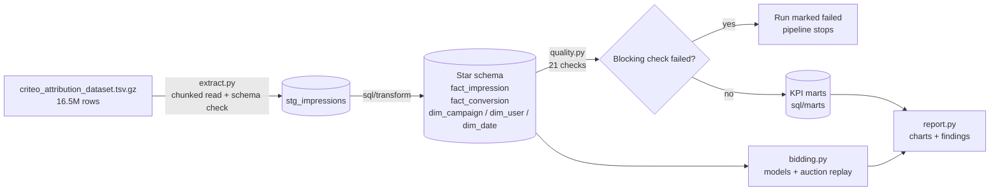
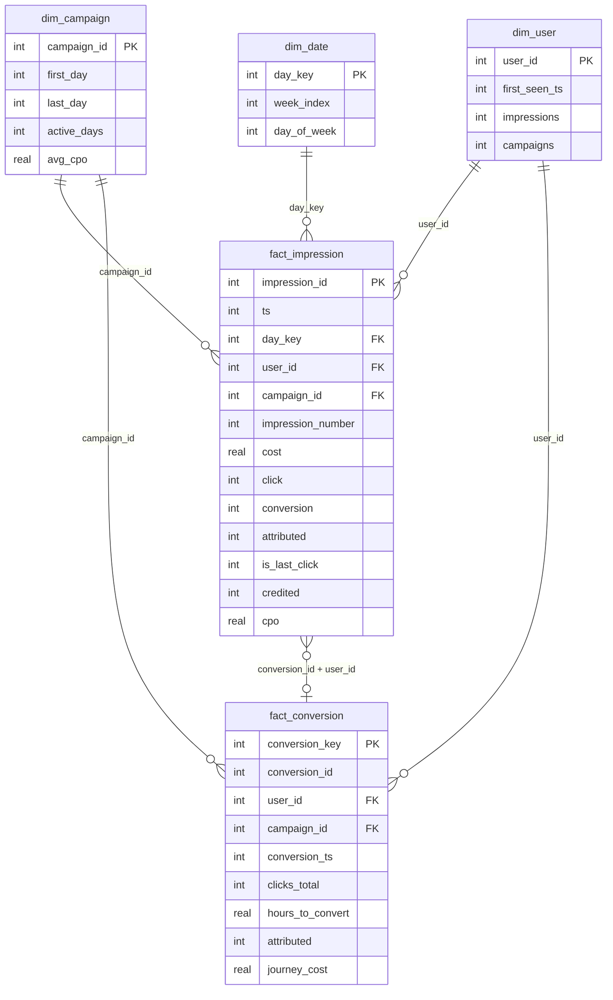
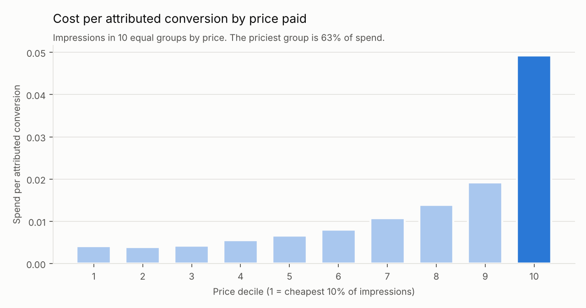
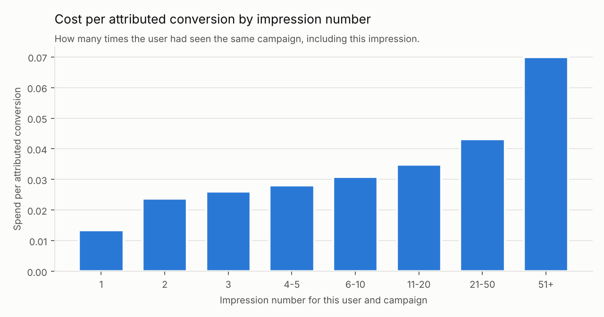
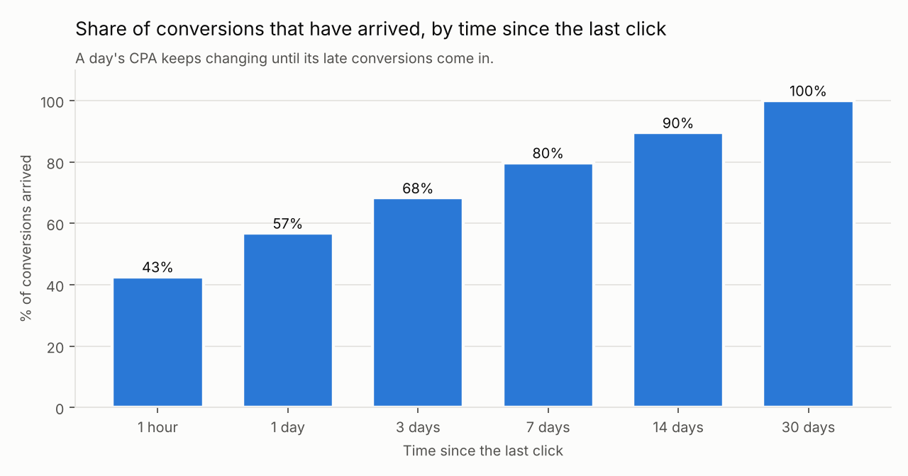

# Ad Auction Analytics

**An ETL pipeline and bidding analysis on 16.5 million real ad impressions from Criteo's live auction traffic.**

The project loads 30 days of real-time bidding logs into a SQLite star schema, checks the data with 21 automated data quality checks, builds KPI tables, and then asks one question an ads team cares about:

> If the budget is cut, which impressions should the bidder stop buying?

**Answer:** bid with a model that predicts which impressions the advertiser will actually credit and pay for. On 10 held-out days, that bidder kept **50.7% of the attributed order value at 20% of the spend**, against 43.2% for a flat bid and 45.7% for a model trained on every conversion. At half the spend it kept 82.1% of the value.



## Key results

| Finding | Number |
|---|---|
| Rows loaded and checked | 16,468,027 impressions, 675 campaigns, 6.1M users, in about 7 minutes |
| Data quality | 21 checks: all 18 blocking checks pass; 2 warnings flag known quirks in the release |
| Most expensive 10% of impressions | 63.1% of spend, 28.6% of attributed conversions |
| Cost per attributed conversion (CPA) | 0.0492 in the priciest 10%, about 9 times the 0.0054 of the cheapest half |
| Impressions to a user who already saw the campaign 10+ times | CPA 2.9 times higher than first impressions (0.0385 vs 0.0134) |
| Conversions that arrive more than 7 days after the last click | 20.3% |
| Attribution-aware model vs conversion model | AUC 0.859 vs 0.835 on the label the advertiser pays for |
| Value kept at 20% of spend | 50.7% with the attribution model, 43.2% with a flat bid |

Every number in this README is generated by the code in [`reports/findings.md`](reports/findings.md). None are typed in by hand.

## The data

The [Criteo Attribution Modeling for Bidding Dataset](https://ailab.criteo.com/criteo-attribution-modeling-bidding-dataset/) is a sample of 30 days of Criteo's live traffic. Each row is an impression that Criteo won in a real-time second-price auction, with the price it paid (`cost`), whether the user clicked, whether they converted within 30 days, and whether the advertiser **attributed** that conversion to Criteo. Criteo is paid a cost per order (`cpo`) only for attributed conversions, so attribution decides what an impression is actually worth.

Details, column definitions and the license are in [`data/README.md`](data/README.md).

## Pipeline



1. **Extract.** The 2.4 GB file is streamed in chunks of 500,000 rows, so memory stays flat. The header is checked against the documented columns before anything loads.
2. **Stage.** Rows land in `stg_impressions` exactly as delivered, so every table downstream can be traced back to the source.
3. **Transform (SQL).** The staged rows become a star schema. The source's `-1` placeholders become `NULL`. Two columns are derived for attribution: `is_last_click` and `credited`, which marks the last click of an attributed conversion (the impression a last-click advertiser pays for). A window function numbers each impression per user and campaign.
4. **Data quality.** 21 checks run after every load (see below). If a blocking check fails, the run is marked failed in `pipeline_runs` and stops before any KPI table is built.
5. **Marts (SQL).** KPI tables for dashboards and the analyses below.
6. **Analysis.** `report.py` builds the charts and `findings.md`. `bidding.py` trains the models and replays the auctions.

Each run is logged in `pipeline_runs` (start, end, rows, status) and each check result in `dq_results`, so the history of the warehouse can be checked later. Re-running the pipeline rebuilds the warehouse from the source, so it is safe to run again.

### Data model



| Table | Grain | Rows |
|---|---|---|
| `fact_impression` | one auction won and shown | 16,468,027 |
| `fact_conversion` | one conversion journey | 438,730 |
| `dim_user` | one user | 6,142,256 |
| `dim_campaign` | one campaign | 675 |
| `dim_date` | one day (relative: day 0 is the first day of traffic) | 31 |
| `mart_campaign_daily` | campaign x day KPIs: impressions, clicks, spend, eCPM, CPC, CPA, ROAS | |
| `mart_daily`, `mart_price_deciles`, `mart_frequency`, `mart_conversion_delay` | analysis tables | |

### Data quality checks

The checks are SQL queries that count the rows breaking a rule. 18 are blocking and 3 are warnings for known properties of the public release. On the full dataset all 18 blocking checks pass.

| Group | Checks |
|---|---|
| Nothing lost or duplicated | row count and total spend match the source; one `dim_user` row per user; one `fact_conversion` row per journey; no null keys |
| Star schema integrity | every fact row joins to `dim_campaign`, `dim_user` and `dim_date` |
| Valid values | flags are 0 or 1; prices are positive; conversions happen after the impression and within the 30-day window |
| Business rules | conversion fields are set exactly when there is a conversion; conversions only follow clicks; only conversions can be attributed; click positions are valid; each journey has one campaign, one conversion time and one attribution; at most one last click per journey |
| Warnings | 2,910 `conversion_id`s are shared by more than one user (collisions from anonymization), 37,648 journeys are missing their last click (Criteo sub-sampled impressions before release), source rows are in time order (passes) |

The first warning changed the design: conversion journeys are keyed by `(conversion_id, user_id)` and not by `conversion_id` alone.

## Analysis

### 1. Expensive impressions do not earn their price



When the 16.5M impressions are split into ten equal groups by the price paid, the most expensive group takes **63.1% of all spend** but brings in 28.6% of attributed conversions. Its cost per attributed conversion is 0.0492, about **9 times** the 0.0054 of the cheapest half, which takes 5.0% of spend and brings in 20.9% of attributed conversions. Pricier impressions do convert more often, just not nearly enough to make up for the price.

### 2. Returns drop as the same user sees a campaign again



First impressions to a user have a CPA of 0.0134. From the 11th impression onward, CPA is 0.0385, **2.9 times higher**, and those impressions are 16.0% of spend. This makes a case for testing a frequency cap. The pattern is a correlation, not a controlled test: users who are shown a campaign many times are different from those shown it once.

### 3. A day's numbers are not final for weeks



42.6% of conversions arrive within an hour of the last click and 56.8% within a day, but **20.3% arrive more than 7 days later**. Any daily CPA or ROAS dashboard on this data needs to refresh recent days for about a month, or show them as incomplete.

### 4. Bidding on what the advertiser pays for

Criteo is paid only when the advertiser attributes a conversion to it, so the value of an impression is `cpo x P(this impression is the credited last click)`. I trained two logistic regression models on days 0 to 20 and tested them on the last 10 days:

| Model | Predicts | AUC | Normalized entropy | AUC on the paid-for label |
|---|---|---|---|---|
| Attribution model | the impression is the last click of an attributed conversion | 0.859 | 0.794 | **0.859** |
| Conversion model | the impression is clicked and followed by any conversion | 0.843 | 0.781 | 0.835 |

Both use the hashing trick on the campaign, nine anonymized context features, campaign crosses, and the user's recent history (time since last click, times they have seen the campaign). Negatives are downsampled to 5% for training and the predictions are recalibrated afterward. The regularization strength is picked on days 18 to 20.

**Replaying the auctions.** In a second-price auction the price is set by the other bidders, not by our bid. So for any logged auction, a new bid at or above the logged price would still have won it at the same price, and a lower bid would have lost it. That makes it possible to test bidding strategies on historical data without a live experiment. Each strategy bids `multiplier x score`, and the multiplier is tuned to hit each budget level.

| Strategy | Value kept at 20% spend | Value kept at 50% spend | Conversions kept at 50% spend |
|---|---|---|---|
| **Attribution model** | **50.7%** | **82.1%** | 80.6% |
| Conversion model | 45.7% | 77.2% | 64.3% |
| Campaign average | 44.3% | 78.6% | 76.2% |
| Flat bid (keep the cheapest) | 43.2% | 77.4% | 81.9% |

Two things stand out:

- The attribution model keeps the most value at every budget level. At half the spend it keeps **25% more attributed conversions than the conversion model** (80.6% vs 64.3%). The conversion model spends on conversions that the advertiser never credits to Criteo.
- A flat bid keeps slightly more conversions by count (81.9%) but less value. Across the dataset, attributed orders from the cheaper half of impressions are worth about a third less on average than those from the pricier half (0.055 vs 0.086 in `cpo`), so counting conversions alone would have picked the wrong strategy.

## How to run

```bash
git clone https://github.com/kennethpangestu/ad-auction-analytics.git
cd ad-auction-analytics
python -m venv .venv && source .venv/bin/activate   # Windows: .venv\Scripts\activate
pip install -r requirements.txt

make test         # 45 unit tests
make sample-run   # full pipeline + analysis on the 1% sample in data/sample/ (about 1 minute)
```

To rebuild everything on the full dataset, download `criteo_attribution_dataset.tsv.gz` (see [`data/README.md`](data/README.md)), put it in `data/raw/`, and run:

```bash
make all          # ETL, then models, replay and charts (about 15 minutes in total on 2 CPU cores)
```

GitHub Actions runs lint, the unit tests and the full pipeline on the sample for every push, on Python 3.12 and 3.13.

## Repository structure

```
ad-auction-analytics/
├── src/adauction/
│   ├── extract.py      # chunked reader and schema checks
│   ├── load.py         # bulk insert into staging
│   ├── pipeline.py     # orchestration, run log
│   ├── quality.py      # the 21 data quality checks
│   ├── models.py       # hashed features, downsampling, recalibration, metrics
│   ├── replay.py       # second-price auction replay
│   ├── bidding.py      # the bidding experiment
│   ├── report.py       # charts, findings.md, metrics.json
│   ├── sample.py       # user-level sampling
│   └── __main__.py     # CLI: etl, analyze, sample
├── sql/
│   ├── schema.sql      # staging, star schema, run metadata
│   ├── transform/      # staging to star schema
│   └── marts/          # KPI and analysis tables
├── tests/              # 45 pytest tests on hand-built data with known answers
├── data/
│   ├── sample/         # 1% user sample of the real data (164,004 rows)
│   └── README.md       # source, columns, license
├── reports/            # generated: findings.md, metrics.json, tables/, figures/
├── .github/workflows/  # CI
└── Makefile
```

## Limitations

- **Transformed prices.** Criteo transformed `cost` and `cpo` before release. They are consistent within the dataset, so comparisons hold, but they are not dollars.
- **Sub-sampled traffic.** Criteo sub-sampled the impressions, which is why about 36% of them are clicked. Rates like CTR are only meaningful relative to each other.
- **The replay can only test bidding less.** Auctions Criteo lost are not in the data, so strategies that bid more than the logged bidder cannot be evaluated. The replay also assumes that dropping an impression does not change what the user does on the impressions that are kept.
- **Relative time.** Timestamps start at 0, so days and hours are relative and the time zone is unknown.

## How I used AI tools

I built this project with Claude as an AI coding assistant. It helped design the pipeline and the bidding experiment, write and debug the Python and SQL, and write the tests. The results come from running the code on the full dataset, and the numbers in this README match the generated `reports/findings.md`, so anyone can rerun the pipeline and check them.

## Data source and license

Code: MIT. Data: the sample in `data/sample/` is part of the Criteo Attribution Modeling for Bidding Dataset and is shared under [CC BY-NC-SA 4.0](https://creativecommons.org/licenses/by-nc-sa/4.0/).

> Eustache Diemert, Julien Meynet, Pierre Galland, Damien Lefortier. *Attribution Modeling Increases Efficiency of Bidding in Display Advertising.* AdKDD & TargetAd Workshop, KDD 2017. https://arxiv.org/abs/1707.06409
